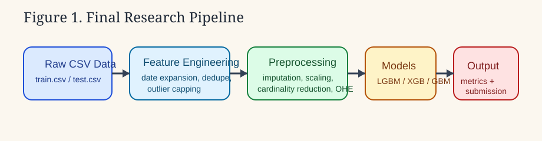
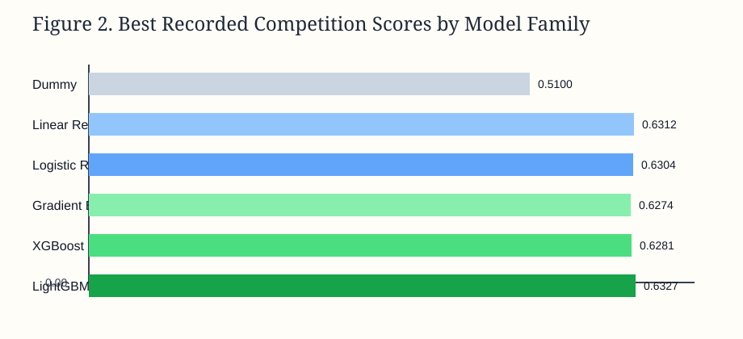
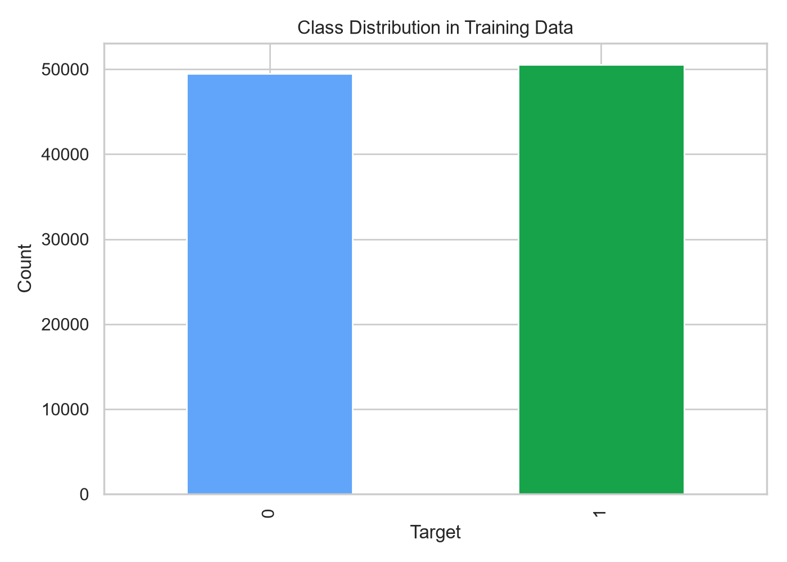
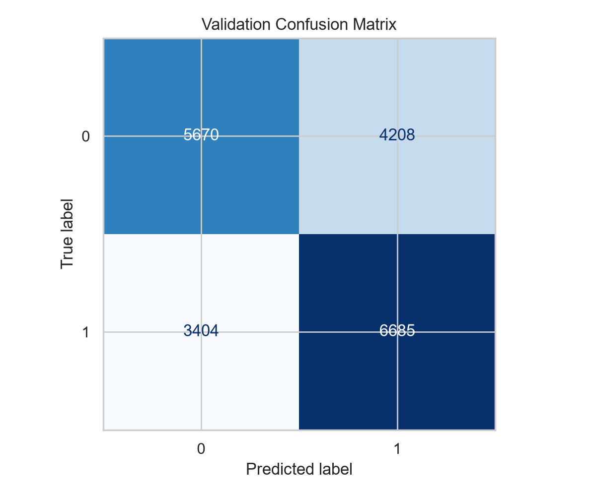

# System Threat Forecaster

An end-to-end binary-classification project for Kaggle's [System Threat Forecaster](https://www.kaggle.com/competitions/System-Threat-Forecaster) competition. The project turns computer telemetry, hardware metadata, operating-system attributes, and security configuration into a malware-risk prediction.

[](https://www.python.org/) [](https://www.kaggle.com/code/sagandeep/23f2003511-notebook-t12025)

## Project at a glance

- Built and compared classical ML pipelines across 45 notebook iterations.
- Developed reusable preprocessing, feature engineering, model selection, and artifact-export modules under `src/system_threat_forecaster/`.
- Best recorded competition score: **0.63270 accuracy**, from experiment `v37` using tuned LightGBM.
- Kept the competition data and generated artifacts out of Git while preserving the experiment trail and report figures.



## Results

The scores below are recorded in [`docs/experiment-history.md`](docs/experiment-history.md); they were not recomputed as part of this documentation update.

| Experiment | Model | Recorded accuracy |
|---|---|---:|
| `v17` | SVC + PCA | 0.61920 |
| `v35` | Tuned XGBoost | 0.62810 |
| `v36` | Tuned Gradient Boosting | 0.62740 |
| `v37` | Tuned LightGBM | **0.63270** |
| `v41` | LightGBM + XGBoost + CatBoost voting ensemble | 0.63070 |



Additional report figures:

| Class balance | Confusion matrix |
|---|---|
|  |  |

## Reproduce the refactored pipeline

### Prerequisites

- Python 3.10 or newer
- Kaggle competition files `train.csv` and `test.csv`

```bash
git clone https://github.com/Sagankaur/Machine-Learning-Classification.git
cd Machine-Learning-Classification
python -m venv .venv
source .venv/bin/activate  # Windows: .venv\Scripts\activate
python -m pip install --upgrade pip
python -m pip install -r requirements.txt
```

Place the downloaded competition files as follows:

```text
data/
├── train.csv
└── test.csv
```

Then run:

```bash
python scripts/train_model.py
```

The script writes the trained pipeline, `submission.csv`, and `metrics.json` to `artifacts/`. Both `data/` and `artifacts/` are intentionally gitignored.

## Repository map

```text
.
├── docs/
│   ├── assets/                  # EDA and evaluation figures
│   ├── experiment-history.md    # 45-version experiment summary
│   └── technical-report.md      # Detailed research report
├── notebooks/
│   ├── system-threat-forecaster-final.ipynb
│   └── mlp-project-legacy.ipynb
├── scripts/
│   ├── train_model.py
│   ├── export_local_notebook.py
│   └── generate_figures.py
├── src/system_threat_forecaster/ # Reusable pipeline package
├── pyproject.toml
└── requirements.txt
```

## Methodology

The refactored path applies deterministic train/validation splitting, date and categorical feature handling, rare-category grouping, numeric clipping, and a tuned LightGBM classifier. The retained notebooks document the broader model search, including linear models, SVC, random forests, boosting libraries, MLPs, and voting ensembles.

For deeper detail, see the [technical report](docs/technical-report.md), [experiment history](docs/experiment-history.md), [ROC curve](docs/assets/roc-curve.png), and [precision-recall curve](docs/assets/precision-recall-curve.png).

## Limitations

- Competition data is not redistributed, so a Kaggle account and manual download are required.
- The best recorded score belongs to an earlier experiment (`v37`), while the curated notebook is the later `v45`; they are related stages, not the same run.
- The score is a competition result, not evidence of production malware detection performance.
- System telemetry and malware prevalence can drift, so a deployed version would require monitoring and periodic retraining.
